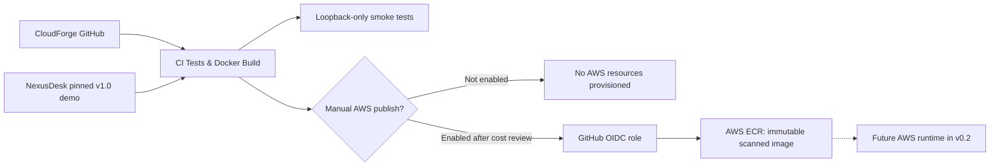

# CloudForge v0.1 — Secure Cloud & DevSecOps Foundation

**Cloud engineering · Docker · Terraform · AWS ECR · GitHub Actions · OIDC · Python**

CloudForge is a portfolio engineering project that turns [NexusDesk v1.0](https://github.com/eddy235/NexusDesk) into a reproducible, security-reviewed container image, introduces automated CI checks, and describes an optional AWS deployment path. It deliberately builds the public **fictional-data demo**—not the operational helpdesk.

> **Current scope: v0.1 source and tests. AWS infrastructure has NOT been provisioned.**

## What works in this release

- Reproducible checkout of NexusDesk at the pinned upstream commit in [`UPSTREAM_VERSION`](UPSTREAM_VERSION).
- Docker image running as a non-root user, collected Django static assets, healthcheck, Gunicorn and no baked secrets.
- Docker Compose with loopback-only port, read-only filesystem, temporary filesystem, dropped Linux capabilities and `no-new-privileges`.
- Python HTTP smoke test that verifies public synthetic content, restrictive CSP, protected login/admin/ticket/report URLs and denied write attempts.
- GitHub Actions CI for unit checks, Terraform static validation, Docker build, and demo smoke checks.
- Terraform IaC for encrypted, immutable [Amazon ECR](https://docs.aws.amazon.com/AmazonECR/latest/userguide/what-is-ecr.html) repository, image scanning, image lifecycle cleanup, and an optional **branch-restricted** GitHub OIDC role.
- A separate **manually triggered** ECR publish workflow. There is **no automatic AWS deployment**.

## Architecture



See [architecture and trust boundaries](docs/ARCHITECTURE.md).

## Quick start (no AWS account needed)

Prerequisites: Git, Python 3.11+, Docker Engine/Desktop with Compose.

```bash
python scripts/fetch_upstream.py
docker compose up --build -d
python scripts/smoke_local.py
docker compose down
```

Open **http://127.0.0.1:8000/demo/** after startup. The local preview is explicitly not a cloud deployment; no employee data, accounts or writes are available.

For offline project validation:

```bash
python -m unittest discover -s tests -v
```

## Review Terraform, without changing AWS

```bash
cd infra/terraform
terraform fmt -check -recursive
terraform init -backend=false
terraform validate
```

`init` downloads the AWS provider plugin. Validation makes **no managed resources**, but ensure your AWS credentials and account are reviewed before using `plan` or `apply`.

The Terraform code creates an ECR repository on **explicit apply only**. An OIDC role is created only when you supply an existing AWS GitHub OIDC provider ARN. It trusts a single repo and its main branch and can push only to the CloudForge ECR repository. No servers, databases, ALBs or NAT gateways are provisioned by v0.1. ECR storage and image scans may incur charges. [Full runbook](docs/RUNBOOK.md).

## GitHub Actions

- **`CI — CloudForge v0.1`**: runs automatically on pushes and PRs. No AWS permissions.
- **`Publish container to ECR (manual)`**: runs only when manually triggered on main. It requires AWS OIDC role and ECR repository URL in GitHub Actions variables. It will fail closed if these have not been configured; it does not provision AWS resources.

The dedicated GitHub repository is **[`eddy235/CloudForge`](https://github.com/eddy235/CloudForge)**. Terraform OIDC trust is limited to this repository’s `main` branch. The starter source is published here; infrastructure has not been provisioned.

## Project materials

- [Architecture](docs/ARCHITECTURE.md)
- [Operator runbook](docs/RUNBOOK.md)
- [Security boundaries](SECURITY.md)
- [Milestone roadmap](ROADMAP.md)

**Portfolio positioning:** Demonstrates infrastructure automation, reproducible containers, supply-chain hygiene, least-privilege workload publishing and deploy safety; the application functionality comes from the separate NexusDesk project.
