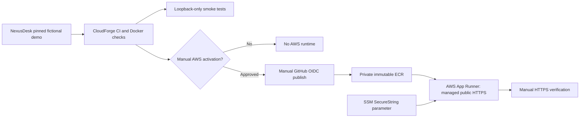

# CloudForge — Secure Cloud & DevSecOps (AWS optional)

**Cloud engineering · Docker · Terraform · AWS ECR · GitHub Actions · OIDC · Python**

CloudForge is a portfolio engineering project that turns [NexusDesk v1.0](https://github.com/eddy235/NexusDesk) into a reproducible, security-reviewed container image, introduces automated CI checks, and describes an optional AWS deployment path. It deliberately builds the public **fictional-data demo**—not the operational helpdesk.

> **Current scope: v0.2 infrastructure and deployment workflow, tested offline. AWS infrastructure has NOT been provisioned and no AWS deployment URL exists yet.**

## AWS-free deployment track

**An AWS account is not required to continue CloudForge.** The project now
includes a Docker build and `render.yaml` for deployment on Render, which
already hosts the separate NexusDesk demo, SecureScan and portfolio site.

- `Dockerfile.render` pulls the exact pinned public NexusDesk SHA during
  the image build so Render can build from the CloudForge repository alone.
- A **Free** Render web-service Blueprint defines a fictional read-only demo,
  a health check, GitHub CI-gated automatic deployments and a generated secret.
- GitHub CI builds and tests the Render image alongside the original local
  Docker and AWS Terraform checks.
- **Deployment is optional and has not been created** by the source changes.
  Review your Render workspace's Free instance-hours and bandwidth first.
- AWS App Runner remains a separate, disabled-by-default learning blueprint
  and has **not** been deployed or tested against an AWS account.

See [AWS-free Render deployment instructions](docs/RENDER_DEPLOYMENT.md).

## What works in this release

- Reproducible checkout of NexusDesk at the pinned upstream commit in [`UPSTREAM_VERSION`](UPSTREAM_VERSION).
- Docker image running as a non-root user, collected Django static assets, healthcheck, Gunicorn and no baked secrets.
- Docker Compose with loopback-only port, read-only filesystem, temporary filesystem, dropped Linux capabilities and `no-new-privileges`.
- Python HTTP smoke test that verifies public synthetic content, restrictive CSP, protected login/admin/ticket/report URLs and denied write attempts.
- GitHub Actions CI for unit checks, Terraform static validation, Docker build, and demo smoke checks.
- Terraform IaC for encrypted, immutable [Amazon ECR](https://docs.aws.amazon.com/AmazonECR/latest/userguide/what-is-ecr.html) repository, image scanning, image lifecycle cleanup, and an optional **branch-restricted** GitHub OIDC role.
- A separate **manually triggered** ECR publish workflow. There is **no automatic AWS deployment**.
- **v0.2:** Opt-in AWS App Runner runtime using private ECR, managed public HTTPS, a small one-instance limit, HTTP health checks, and an IAM role that reads only one pre-created SSM SecureString for the Django secret.
- **v0.2:** `enable_runtime=false` by default; runtime creation requires an already published immutable Git-SHA image and an existing SSM parameter ARN. App Runner cost review is mandatory before any apply.
- **v0.2:** Standalone HTTPS smoke script and manually triggered GitHub verification with no AWS credentials.

## Architecture



See [architecture and trust boundaries](docs/ARCHITECTURE.md) and
[v0.2 AWS deployment runbook](docs/AWS_DEPLOYMENT.md).

## Quick start (no AWS account needed)

Prerequisites: Git, Python 3.11+, Docker Engine/Desktop with Compose.

```bash
python scripts/fetch_upstream.py
docker compose up --build -d
python scripts/smoke_local.py
docker compose down
```

Open **http://127.0.0.1:8000/demo/** after startup. The local preview is explicitly not a cloud deployment; no employee data, accounts or writes are available.

For offline project validation:

```bash
python -m unittest discover -s tests -v
```

## Review Terraform, without changing AWS

```bash
cd infra/terraform
terraform fmt -check -recursive
terraform init -backend=false
terraform validate
```

`init` downloads the AWS provider plugin. Validation makes **no managed resources**, but ensure your AWS credentials and account are reviewed before using `plan` or `apply`.

Terraform creates an ECR registry on **explicit apply only**. An OIDC publishing role is created only when you supply a reviewed existing GitHub OIDC provider ARN. An AWS App Runner service is added **only when** `enable_runtime=true` and an immutable published image SHA plus a pre-created SSM secret ARN are supplied. No database, NAT gateway, ALB or EC2 server is provisioned. AWS App Runner has ongoing compute charges, including provisioned memory when idle. [Deployment and cost review](docs/AWS_DEPLOYMENT.md).

## GitHub Actions

- **`CI — CloudForge`**: runs automatically on pushes and PRs. No AWS permissions.
- **`Publish container to ECR (manual)`**: runs only when manually triggered on main. It requires AWS OIDC role and ECR repository URL in GitHub Actions variables. It will fail closed if these have not been configured; it does not provision AWS resources.
- **`Verify AWS demo HTTPS (manual, no AWS credentials)`**: checks a user-supplied HTTPS origin only after an intentional deployment, including security headers and blocked private/write routes.

The dedicated GitHub repository is **[`eddy235/CloudForge`](https://github.com/eddy235/CloudForge)**. Terraform OIDC trust is limited to this repository’s `main` branch. The starter source is published here; infrastructure has not been provisioned.

## Project materials

- [Render deployment (no AWS account required)](docs/RENDER_DEPLOYMENT.md)
- [Optional AWS v0.2 deployment instructions, costs and rollback](docs/AWS_DEPLOYMENT.md)
- [Architecture](docs/ARCHITECTURE.md)
- [Operator runbook](docs/RUNBOOK.md)
- [Security boundaries](SECURITY.md)
- [Milestone roadmap](ROADMAP.md)

**Release distinction:** v0.2 code, Terraform validation and local container verification can be complete **without claiming an actual AWS service has been deployed**. Do not link to an invented App Runner URL.

**Portfolio positioning:** Demonstrates infrastructure automation, reproducible containers, supply-chain hygiene, least-privilege workload publishing and deploy safety; the application functionality comes from the separate NexusDesk project.
