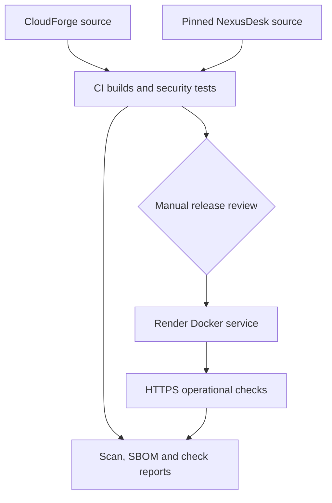
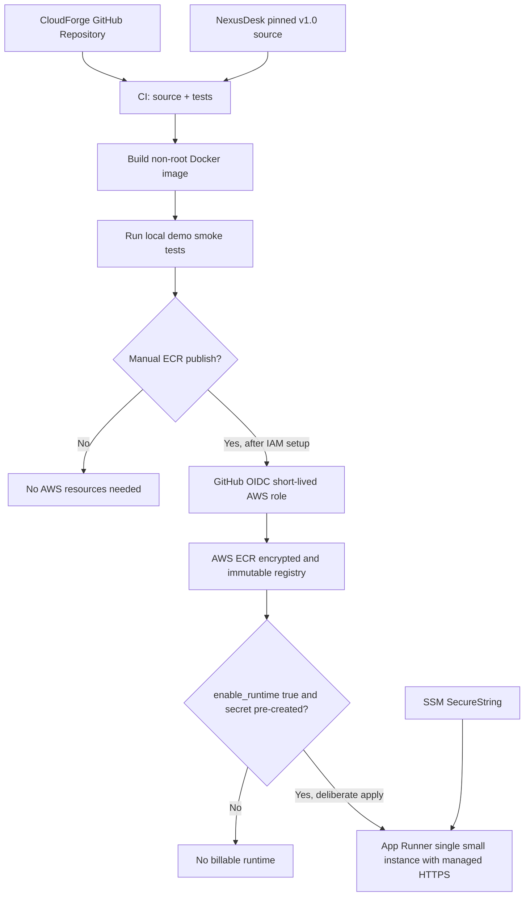

# CloudForge architecture

## Goal
Practice cloud delivery and supply-chain security around the isolated **fictional NexusDesk demo**. The main track uses the existing Render Free service; AWS remains an optional, unprovisioned reference.

## Active Render track

The base image is digest-pinned and workflow actions are SHA-pinned. The image
scan fails on fixable HIGH/CRITICAL vulnerabilities and retains all findings.
The SBOM inventories the CI image; dependency ranges still resolve during the
separate Render build. Automatic deployments are off, Render uses TCP health
checks and the service is not managed by the optional Blueprint.

The checker verifies the currently deployed app without cloud credentials. It
does not deploy code or attest the running image's source revision. See
[operations and evidence limits](OPERATIONS.md).

## Optional AWS reference

### Threat boundaries

- GitHub pull requests execute code without AWS permissions; container CI never accesses AWS.
- Manual ECR publish only runs on `main`, requires approved AWS role ARN and registry URL, and uses OIDC rather than stored AWS access keys.
- IAM trust conditions limit `aud=sts.amazonaws.com` and `sub=repo:eddy235/CloudForge:ref:refs/heads/main` (change only if the repo's actual owner/name differs).
- Docker runs without root privileges, with read-only root filesystem and no Linux capabilities in local Compose.
- The app runs with `NEXUSDESK_DEMO_MODE=true`; its middleware rejects private routes and write requests.
- No database, admin credentials, user data, public AWS runtime, NAT gateway, or ALB are created in v0.1.

### v0.1 vs v0.2

The v0.1 ECR registry only stores approved images; it does not serve HTTP. The optional v0.2 managed App Runner service provides public HTTPS, scoped ECR pull and SSM secret access, a health check, and bounded single-instance scaling. AWS service logs are available when deployed; no monitoring alarm, budget or actual service is created by CI. The runtime is disabled by default and requires explicit configuration before any AWS cost.
