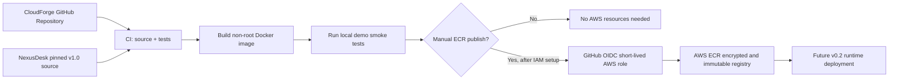

# CloudForge v0.1 architecture

## Goal
Practice cloud supply-chain security and Infrastructure as Code **before** paying for workloads. The application is the isolated **fictional NexusDesk demo**, not the operational helpdesk.

### Threat boundaries

- GitHub pull requests execute code without AWS permissions; container CI never accesses AWS.
- Manual ECR publish only runs on `main`, requires approved AWS role ARN and registry URL, and uses OIDC rather than stored AWS access keys.
- IAM trust conditions limit `aud=sts.amazonaws.com` and `sub=repo:eddy235/CloudForge:ref:refs/heads/main` (change only if the repo's actual owner/name differs).
- Docker runs without root privileges, with read-only root filesystem and no Linux capabilities in local Compose.
- The app runs with `NEXUSDESK_DEMO_MODE=true`; its middleware rejects private routes and write requests.
- No database, admin credentials, user data, public AWS runtime, NAT gateway, or ALB are created in v0.1.

### v0.1 vs v0.2

The ECR registry is just a place to **store** verified container images. It does not serve HTTP. A public AWS application endpoint, TLS certificate, logging, budget alerts and runtime isolation belong to v0.2, after explicit cost review.
