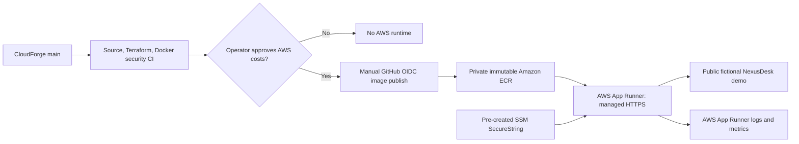

# CloudForge v0.2 — AWS Deployment Runbook

> **Status at release:** Infrastructure code is implemented and can be validated offline.
> **No AWS service has been deployed, no AWS account has been accessed, and no AWS resources
> have been provisioned by this release.** Enabling AWS services may incur charges.

## Architecture

The first AWS runtime uses **AWS App Runner** for a managed public HTTPS endpoint
without an AWS-managed load balancer, self-managed servers, or NAT gateway.
It serves only the **NexusDesk fictional read-only demonstration**.



App Runner exposes HTTPS on an AWS-managed `*.awsapprunner.com` domain;
it terminates TLS before reaching the container. The container's
`DJANGO_SECURE_SSL_REDIRECT=false` prevents **internal HTTP health checks**
from being redirected. External HTTP handling is governed by the App Runner
service. It does **not** imply the same setting is safe on a directly exposed
HTTP server. `DJANGO_ENABLE_HSTS=true` and secure cookies are enabled.

## What v0.2 provisions when enabled

- An App Runner ECR **access role** used by the service to pull an approved
  private image, and a separate runtime **instance role** restricted to
  `ssm:GetParameters` for exactly one demo-secret ARN.
- A maximum of **one** `0.25 vCPU / 0.5 GB` App Runner instance, with
  automatic deployments **disabled**.
- Health checks at `/health/` and the AWS-managed public HTTPS URL.
- No RDS database, NAT gateway, ALB, EC2 instance, SSH ingress, custom domain,
  operational ticket accounts, or external dashboard.

**Cost:** App Runner charges for provisioned memory even when idle, plus active
CPU/memory; ECR image storage, scanning and logging can add charges. **There is
no free-running promise.** Review the current official region-specific pricing
and configure AWS Budget alerts before enabling the service:
https://aws.amazon.com/apprunner/pricing/

## Step 0 — Before any Terraform apply

1. Use an AWS account that you control. Enable MFA and create a low-spend
   billing budget with email alerts. An AWS Budget alert is **not** an
   automatic spending cap.
2. Choose one AWS region (example `eu-west-1`) and verify current pricing and
   feature availability. The examples assume the same account and region for
   ECR, SSM Parameter Store, App Runner and the GitHub OIDC role.
3. Install and authenticate AWS CLI and Terraform; use short-lived credentials
   from your authorized identity provider, not committed access keys.
4. Run `aws sts get-caller-identity` to confirm **which AWS account** is active.
5. Start with `enable_runtime=false` in `infra/terraform/terraform.tfvars`.
   Use `terraform fmt -check -recursive`, `terraform init` and
   `terraform validate` to inspect without creating resources.

## Step 1 — Review and provision only ECR + optional GitHub push role

1. In AWS IAM, confirm whether the GitHub OIDC provider
   `https://token.actions.githubusercontent.com` with audience
   `sts.amazonaws.com` already exists. If absent, create it **once** under
   IAM → Identity providers. Do not create conflicting duplicate providers.
2. Set `github_oidc_provider_arn` in local Terraform settings to that provider
   ARN if you want the narrowly restricted GitHub publish role.
3. Review `terraform plan` and ensure **no App Runner service** appears while
   `enable_runtime=false`. Review the ECR resource and IAM trust/policy.
4. Only if you accept ECR/storage risk, run `terraform apply` and capture
   `terraform output -raw ecr_repository_url` and
   `terraform output -raw github_oidc_role_arn`.
5. In your **CloudForge** GitHub repository, add Actions **variables**:
   `AWS_ROLE_ARN`, `ECR_REPOSITORY_URI`, and `AWS_REGION`.
   Do not upload AWS access keys.
6. Trigger **Publish container to ECR (manual)** from `main`, once reviewed.
   This builds only the pinned NexusDesk fictional demo and pushes an ECR tag
   equal to the 40-character **CloudForge commit SHA**.
7. Confirm the image actually exists in ECR using AWS CLI or the console.
   Write down the **published 40-character commit SHA**, not a moving `latest`
   tag. ECR is configured with immutable tags.

The GitHub role has no App Runner service-management permission. An ECR image
push does **not** automatically deploy the service.

## Step 2 — Store the demo secret outside Terraform state

In AWS Systems Manager → Parameter Store, create one standard
**SecureString** named `/cloudforge/demo-secret` (or another deliberate name).
Use a randomly generated, long Django secret; never use the literal example
values in documentation and **never put the secret's value** in GitHub, Terraform
variables, source files, Terraform state, logs, or chat.

Copy only the resulting SSM parameter **ARN**, of the form
`arn:aws:ssm:REGION:ACCOUNT:parameter/cloudforge/demo-secret`.
The App Runner runtime IAM role can read this single parameter.
If using a customer-managed KMS encryption key, review and add narrowly scoped
`kms:Decrypt` permissions for that key before attempting deployment;
the starter assumes the standard AWS-managed SSM key.

## Step 3 — Explicitly enable the paid runtime

After confirming AWS cost alerts, ECR image existence and the secret ARN, set
the following in your local `infra/terraform/terraform.tfvars`:

```hcl
enable_runtime            = true
runtime_image_tag         = "PUT_THE_EXACT_40_CHARACTER_PUBLISHED_GIT_SHA_HERE"
demo_secret_parameter_arn = "arn:aws:ssm:REGION:ACCOUNT:parameter/cloudforge/demo-secret"
```

Keep the previously reviewed OIDC provider ARN and region settings. Then:

```bash
cd infra/terraform
terraform fmt -check -recursive
terraform init
terraform validate
terraform plan -out=cloudforge-v02.tfplan
```

**Review the entire plan** for instance size, image tag, IAM privileges,
App Runner resources and charges; apply only after approval:

```bash
terraform apply cloudforge-v02.tfplan
terraform output -raw apprunner_service_url
terraform output -raw apprunner_service_arn
```

An App Runner service will incur charges when running, including idle
provisioned memory. Never set `enable_runtime=true` solely to make a CI run
pass. This project has no automated `terraform apply` pipeline.

### Host-header behavior

The first managed App Runner DNS name is randomly assigned at service creation.
The demo-only Django setting `DJANGO_ALLOWED_HOSTS=.awsapprunner.com`
accepts AWS App Runner hostnames; it does **not** accept arbitrary domains.
If moving to a custom domain or real users, replace it with an explicit
reviewed host allowlist and reassess proxies and security controls.

## Step 4 — Verify the public AWS endpoint

From your local terminal:

```bash
python scripts/smoke_cloud.py https://YOUR-AWS-APP-RUNNER-ORIGIN
```

Alternatively use **Verify AWS demo HTTPS (manual, no AWS credentials)** in
GitHub Actions, providing the HTTPS origin. The smoke verifier checks the
fictional demo, security headers, static styles, and that private routes and
POST writes are inaccessible. It must **not** be run against a real helpdesk.

Also manually review mobile layout, external TLS certificate, CloudWatch logs,
current instance status, AWS costs and the original NexusDesk demo's behavior.

## Rollback / stop-cost procedure

- **Rollback to previously approved image:** set `runtime_image_tag` to the
  earlier **already published immutable** commit SHA, inspect `terraform plan`,
  and apply intentionally. Do not enable automatic image deployments.
- **Pause paid running compute:** obtain the ARN from Terraform output and use
  the AWS Console App Runner service **Pause** action, or authorized CLI
  `aws apprunner pause-service --service-arn YOUR_SERVICE_ARN`. AWS documents
  that pausing removes provisioned compute; your application is unavailable,
  but ECR/storage and other AWS charges may remain.
- **Full teardown:** plan a deliberate `terraform destroy` after documenting
  the resource inventory and deleting stored ECR images if necessary
  (`force_delete=false` protects against accidental image loss).
  Review IAM, SSM and log retention separately. Deleting a service removes its
  App Runner URL; pause if you need to retain the URL for future demonstrations.

Never assume a bill is zero merely because you stopped sending traffic.

## Known limitations

- No AWS account access, apply, real deployment or external cloud smoke-test is
  included in the v0.2 code milestone itself.
- The SSM SecureString is pre-created and its rotation is manual. After secret
  rotation, redeploy/restart deliberately; App Runner reads the secret at
  deployment rather than automatically fetching changes.
- AWS-managed TLS, App Runner default logs/metrics and a one-instance scaling
  maximum are a starter, not a full security/observability solution.
- Local Terraform state is intentionally ignored; use a protected remote state
  backend before collaborating or managing real infrastructure.
- This is **not** an independent penetration-tested system.
